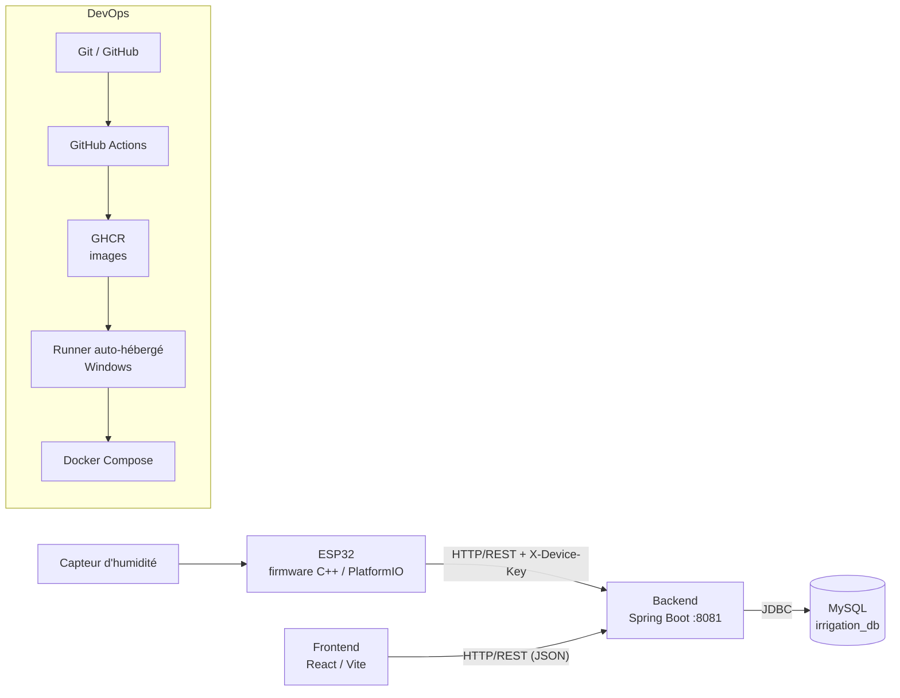

# Irrigation intelligente IoT : projet DevOps


Prototype de système d'irrigation connecté : un **ESP32** relié à un capteur d'humidité du sol envoie ses mesures à une **API Spring Boot**, qui les stocke dans **MySQL** ; une interface **React** permet de les consulter et d'envoyer des commandes de démarrage ou d'arrêt de l'irrigation. Le projet met en œuvre une chaîne **DevOps** complète : Git/GitHub, Docker, Docker Compose, GitHub Actions, GitHub Container Registry (GHCR) et runner auto-hébergé.

> Projet réalisé dans le cadre d'un travail de Master consacré au DevOps et à l'Internet des objets.

---

## Sommaire

1. [Fonctionnalités](#fonctionnalités)
2. [Architecture](#architecture)
3. [Structure du dépôt](#structure-du-dépôt)
4. [Technologies](#technologies)
5. [Prérequis](#prérequis)
6. [Démarrage rapide avec Docker Compose](#démarrage-rapide-avec-docker-compose)
7. [Développement local par composant](#développement-local-par-composant)
8. [Configuration et secrets](#configuration-et-secrets)
9. [API REST](#api-rest)
10. [Firmware ESP32](#firmware-esp32)
11. [CI/CD et déploiement](#cicd-et-déploiement)
12. [Réseau : quelle adresse utiliser ?](#réseau--quelle-adresse-utiliser-)
13. [Dépannage](#dépannage)
14. [État de validation et limites connues](#état-de-validation-et-limites-connues)
15. [Perspectives](#perspectives)
16. [Organisation du travail](#organisation-du-travail)
17. [Auteurs et licence](#auteurs-et-licence)

---

## Fonctionnalités

- **Acquisition** : lecture périodique du capteur d'humidité du sol (GPIO34) avec moyenne de plusieurs lectures et calibration.
- **Transmission** : envoi des mesures au backend par HTTP/REST (JSON), authentifié par une clé de dispositif.
- **Stockage** : enregistrement des mesures, des commandes et des paramètres dans MySQL.
- **Consultation** : tableau de bord, historique des mesures, historique des commandes.
- **Commande** : demande de démarrage (`START`) ou d'arrêt (`STOP`) de l'irrigation depuis l'interface.
- **Échange de commandes** : l'ESP32 interroge régulièrement le backend, traite la commande, puis renvoie son résultat.
- **Paramétrage** : seuil d'humidité et mode automatique ; alertes prévues au contrat d'API.
- **DevOps** : vérifications, construction et publication d'images, déploiement et téléversement du firmware automatisés.

---

## Architecture



### Flux d'une mesure

1. Le capteur fournit une lecture analogique à l'ESP32.
2. Le firmware la convertit selon les paramètres de calibration.
3. Il envoie une requête `POST /api/v1/measurements` au backend.
4. Le backend valide et enregistre la mesure.
5. Le frontend interroge l'API pour afficher la dernière mesure et l'historique.

### Flux d'une commande

1. L'utilisateur demande `START` ou `STOP` dans l'interface.
2. Le frontend envoie la demande au backend, qui l'enregistre (statut `PENDING`) et répond **HTTP 202**.
3. L'ESP32 interroge `GET /api/v1/device/commands/next` et reçoit la commande.
4. Le firmware la traite puis envoie `POST /api/v1/device/commands/{id}/result`.
5. L'interface peut afficher le statut obtenu (`EXECUTED`, `REJECTED`, `FAILED`, `EXPIRED`).

> **Important :** une réponse 202 signifie « demande acceptée pour traitement ». Elle ne garantit ni la réception par l'ESP32 ni l'actionnement de la pompe.

---

## Structure du dépôt

```text
irrigation-intelligente-iot/
├── backend/                  # Java / Spring Boot : API, configuration, tests, Dockerfile
├── frontend-react/           # React / Vite : pages, composants, appels API, Dockerfile, nginx.conf
├── firmware/                 # ESP32 : platformio.ini, src/main.cpp
│   └── src/secrets.h         # LOCAL uniquement, exclu du dépôt (voir secrets_example.h)
├── .github/workflows/
│   └── ci-cd.yml             # Pipeline GitHub Actions
├── .env.example              # Noms des variables d'environnement (sans valeur réelle)
└── .gitignore
```

---

## Technologies

| Couche | Technologies |
|---|---|
| Firmware | C++ (framework Arduino), PlatformIO, ESP32 Dev Module, `HTTPClient` |
| Backend | Java 21, Spring Boot, JPA/Hibernate, API REST |
| Base de données | MySQL 8 (base `irrigation_db`) |
| Frontend | React, Vite, React Router, TanStack Query, bibliothèques de graphiques |
| Conteneurs | Docker, Docker Compose, nginx (serveur du frontend) |
| CI/CD | GitHub Actions, GHCR, runner auto-hébergé (Windows) |

---

## Prérequis

| Outil | Usage |
|---|---|
| Git | Gestion du code |
| Docker Desktop (avec Docker Compose) | Exécution conteneurisée |
| JDK 21 et Maven 3.9+ | Backend en développement local |
| Node.js 22 et npm | Frontend en développement local |
| VS Code + extension PlatformIO | Firmware ESP32 |
| ESP32 Dev Module, capteur d'humidité, câble USB | Partie matérielle |

---

## Démarrage rapide avec Docker Compose

```bash
# 1. Cloner le dépôt
git clone https://github.com/<utilisateur>/<depot>.git
cd <depot>

# 2. Créer le fichier d'environnement local à partir de l'exemple
cp .env.example .env
#    Puis renseigner les valeurs dans .env (ne jamais le commiter) :
#    MYSQL_DATABASE, MYSQL_ROOT_PASSWORD, IRRIGATION_DEVICE_KEY

# 3. Construire et démarrer les services
docker compose up -d --build

# 4. Vérifier l'état des conteneurs et les logs
docker compose ps
docker compose logs -f backend
```

Services lancés : **frontend** (nginx, port 80 du conteneur), **backend** (Spring Boot, port interne 8081) et **MySQL** (volume persistant). Le port 8081 du backend est publié sur un port de la machine hôte défini dans le fichier Compose ; consultez celui-ci pour connaître les ports effectivement exposés.

Pour arrêter les services :

```bash
docker compose down          # arrête et supprime les conteneurs, conserve le volume MySQL
docker compose down -v       # ATTENTION : supprime aussi le volume, donc les données
```

---

## Développement local par composant

### Backend

```bash
cd backend
# Variables facultatives (valeurs par défaut adaptées à un MySQL local)
export SPRING_DATASOURCE_URL="jdbc:mysql://localhost:3306/irrigation_db"
export SPRING_DATASOURCE_USERNAME="<utilisateur>"
export SPRING_DATASOURCE_PASSWORD="<mot de passe>"
export IRRIGATION_DEVICE_KEY="<clé du dispositif>"

mvn spring-boot:run
```

L'API écoute sur `http://localhost:8081`. Test rapide :

```powershell
Invoke-RestMethod -Uri "http://localhost:8081/api/v1/health"
```

### Frontend

```bash
cd frontend-react
echo "VITE_API_URL=http://localhost:8081/api/v1" > .env
npm ci
npm run dev        # serveur de développement Vite
npm run lint       # contrôle de style
npm run build      # build de production
```

### Firmware

```bash
cd firmware
cp src/secrets_example.h src/secrets.h     # puis éditer secrets.h
pio run                                    # compilation
pio run -t upload                          # téléversement vers l'ESP32
pio device monitor                         # moniteur série
```

---

## Configuration et secrets

Aucune valeur sensible ne doit être versionnée.

| Élément | Où le définir | Utilisé par |
|---|---|---|
| SSID et mot de passe Wi-Fi | `firmware/src/secrets.h` (local, ignoré par Git) | Firmware |
| URL de l'API et clé de dispositif (côté ESP32) | `firmware/src/secrets.h` ou constantes du firmware | Firmware |
| `IRRIGATION_DEVICE_KEY` | `.env` local / variable d'environnement | Backend (doit être identique à la clé du firmware) |
| `SPRING_DATASOURCE_URL`, `SPRING_DATASOURCE_USERNAME`, `SPRING_DATASOURCE_PASSWORD` | Variables d'environnement | Backend |
| `MYSQL_DATABASE`, `MYSQL_ROOT_PASSWORD` | `.env` local | Conteneur MySQL |
| `VITE_API_URL` | `frontend-react/.env` ou argument de build | Frontend |
| Jeton d'accès à GHCR | Secret du dépôt GitHub | Workflow GitHub Actions |

Bonnes pratiques appliquées ou recommandées :

- Fichier `secrets.h` exclu par `.gitignore`, avec un fichier d'exemple sans valeur réelle.
- Secrets de pipeline stockés dans les **secrets GitHub**, jamais affichés dans les logs.
- Ne pas publier de mot de passe, de clé de dispositif ni de jeton dans le dépôt, les captures d'écran ou le rapport.
- Si un secret a déjà été commité, le considérer comme compromis et le **remplacer**.
- Ne pas exposer inutilement le port MySQL (3306) hors de la machine.

---

## API REST

Préfixe : `/api/v1`. Les endpoints marqués « clé » exigent l'en-tête `X-Device-Key`.

| Méthode et chemin | Accès | Rôle |
|---|---|---|
| `GET /health` | Frontend | État du service |
| `POST /measurements` | ESP32 (clé) | Enregistrer une mesure |
| `GET /measurements/latest` | Frontend | Dernière mesure |
| `GET /measurements/history` | Frontend | Historique paginé |
| `GET /irrigation/status` | Frontend | État courant de l'irrigation |
| `POST /irrigation/commands` | Frontend | Créer une commande `START` / `STOP` (réponse 202) |
| `GET /irrigation/commands/{id}` | Frontend | Consulter une commande |
| `GET /irrigation/history` | Frontend | Historique paginé des commandes |
| `GET /device/commands/next` | ESP32 (clé) | Récupérer la prochaine commande (sans contenu si aucune) |
| `POST /device/commands/{id}/result` | ESP32 (clé) | Transmettre le résultat d'exécution |
| `GET` / `PUT /settings` | Frontend | Lire ou modifier le seuil et le mode automatique |
| `GET /alerts`, `PATCH /alerts/{id}/acknowledgement` | Frontend | Alertes (prévues au contrat OpenAPI) |

Exemple de mesure envoyée par l'ESP32 :

```http
POST /api/v1/measurements
Content-Type: application/json
X-Device-Key: <clé du dispositif>

{
  "deviceId": "ESP32-001",
  "soilMoisture": 42.5,
  "measuredAt": "2025-01-15T10:30:00Z"
}
```

Statuts d'une commande : `PENDING` → `EXECUTED` | `REJECTED` | `FAILED` | `EXPIRED`.

Le contrat détaillé figure dans `frontend-react/openapi.yaml`.

---

## Firmware ESP32

- **Carte** : ESP32 Dev Module, capteur analogique sur **GPIO34**.
- **Boucle** : une mesure environ toutes les 10 000 ms, une interrogation des commandes environ toutes les 5 000 ms.
- **Mesure** : moyenne de 10 lectures, puis conversion linéaire entre `VALEUR_SECHE` (0) et `VALEUR_HUMIDE` (2000), bornée entre 0 et 100 %.
- **Identification** : `deviceId` = `ESP32-001`, clé transmise dans `X-Device-Key`.
- **Simulation** : `MODE_SIMULATION = true` signifie que les commandes sont simulées ; elles ne prouvent pas l'actionnement d'une pompe.

> **Calibration provisoire** : les valeurs 0 et 2000 sont à ajuster après des mesures réelles (capteur à l'air libre = sec, capteur dans l'eau = humide).

Montage de principe : alimentation et masse du capteur reliées à l'ESP32, sortie analogique sur GPIO34, liaison USB vers l'ordinateur. Le pilotage d'un relais et d'une pompe est envisagé mais **non validé physiquement** à ce stade.

---

## CI/CD et déploiement

Le workflow `.github/workflows/ci-cd.yml` est organisé en jobs séparés par composant afin de localiser rapidement les erreurs :

| Job | Rôle |
|---|---|
| Backend | Environnement Java/Maven, service MySQL de test, exécution des tests |
| Frontend | Environnement Node.js, installation des dépendances, lint, compilation de production |
| Firmware | Compilation PlatformIO dans une image `firmware-builder` |
| Construction et publication | Construction des images Docker et publication sur **GHCR** (authentification par secret GitHub) |
| Déploiement | Sur le runner auto-hébergé : récupération des images sur GHCR puis redémarrage des services avec Docker Compose |
| `flash_firmware` | Sur le runner auto-hébergé : compilation puis téléversement vers l'ESP32 (port série observé : `COM7`) |

Les conditions de déclenchement (événements Git, branches) sont définies dans `ci-cd.yml`.

### Runner auto-hébergé

Un runner installé sur une machine Windows de l'équipe (dossier observé : `D:\github-runner`) exécute les jobs qui ont besoin de ressources locales : Docker Desktop pour le déploiement, port USB-série et PlatformIO pour le firmware. Il doit être **en ligne** et Docker Desktop **démarré** pour que ces jobs s'exécutent.

> Un runner auto-hébergé exécute du code sur votre machine : limitez son usage aux branches de confiance et n'exposez pas ses permissions ou ses secrets inutilement.

Lecture d'un run : onglet **Actions** → workflow → job → étape → logs. Distinguer un job **défini** (présent dans le YAML), **exécuté** (il a tourné) et **réussi** (statut vert avec logs).

---

## Réseau : quelle adresse utiliser ?

La même API n'est pas jointe avec la même adresse selon l'appelant.

| Appelant | Cible | Adresse à utiliser |
|---|---|---|
| Navigateur / frontend | Backend | Développement local : `http://localhost:8081/api/v1` ; conteneur : `/api/v1` (proxy nginx vers le service `backend`) |
| Backend dans un conteneur | MySQL | Nom du **service MySQL** du réseau Docker (pas `localhost`) |
| ESP32 | Backend | **IP locale de la machine hôte** + port publié (par exemple `http://192.168.1.3:8082/api/v1` dans une configuration observée), jamais `localhost` |

---

## Dépannage

| Symptôme | Cause probable | Vérification |
|---|---|---|
| L'ESP32 ne se connecte pas | SSID ou mot de passe incorrect, réseau non 2,4 GHz | `secrets.h`, moniteur série |
| Pas de code HTTP côté ESP32 | Backend injoignable (mauvaise IP ou mauvais port, pare-feu) | Tester l'URL depuis un autre poste du réseau |
| Réponse `401` | Clé de dispositif différente entre firmware et backend | Comparer les deux clés |
| Backend qui ne démarre pas dans Docker | URL JDBC avec `localhost`, MySQL pas encore prêt, identifiants erronés | `docker compose logs backend` et `docker compose logs mysql` |
| Le frontend n'atteint pas l'API | `VITE_API_URL` incorrect ou ancien build | Onglet *Network* du navigateur, valeur de la variable au moment du build |
| Port déjà utilisé | Autre processus sur le port publié | Changer le port publié dans Compose |
| Données perdues après redémarrage | Volume supprimé (`down -v`) | `docker volume ls` |

Commandes utiles :

```bash
docker ps                    # conteneurs en cours
docker ps -a                 # tous les conteneurs
docker images                # images locales
docker compose ps            # services du projet
docker compose logs -f       # logs en continu
git branch -a                # branches locales et distantes
git fetch                    # mise à jour des références distantes
```

---

## État de validation et limites connues

Cette section distingue ce qui est écrit de ce qui est prouvé. À compléter avec les résultats réels des tests.

| Élément | État |
|---|---|
| API des mesures (réponse JSON sur le port 8081) | Réponse obtenue lors d'un test antérieur ; 
| Chaîne complète ESP32 → API → base → interface 
| Pilotage physique de la pompe | **Non validé** (mode simulation) |
| Workflow GitHub Actions | Défini ; 
| Déploiement par runner auto-hébergé | Défini ; 
| Téléversement automatique du firmware | Dépend du matériel, du port série et de `secrets.h` |

Limites et anomalies identifiées :

- Calibration du capteur **provisoire**.
- Anomalie observée sur la commande **Arrêter** : l'absence de requête réseau a été constatée lors d'un diagnostic ; correction et test de non-régression à confirmer.
- Anomalie observée sur la **pagination** : la valeur `page=NaN` a été relevée ; piste d'analyse : la valeur de pagination calculée côté frontend n'est pas un entier valide (par exemple champ de pagination absent de la réponse).
- Commandes **délivrées mais sans résultat** : pas encore de politique d'expiration, de reprise ou d'échec explicite.
- Cohérence des URL et des ports entre exécution locale, Docker et ESP32 à maintenir.
- Échanges en HTTP sur réseau local : adaptés à un prototype, pas à une exposition publique.

---


---

## Organisation du travail

| Branche | Rôle |
|---|---|
| `main` | Branche de référence, base des déploiements |
| `feature/backend` | Développement de l'API Spring Boot |
| `feature/firmware-esp32` | Développement du firmware ESP32 |
| `feature/frontent-reactJS` | Développement de l'interface React  |

Flux conseillé : créer ou mettre à jour une branche de fonctionnalité, vérifier en local (tests, lint, build), ouvrir une *pull request* vers `main`, attendre le résultat du workflow, puis fusionner.

---

## Auteurs et licence

- **Auteurs** : Mouhamadou Lamine DIOUF/ Ami collé NIANG
- **Formation** : Master data science et genie logiciel — Université Alioune Diop de bambey
